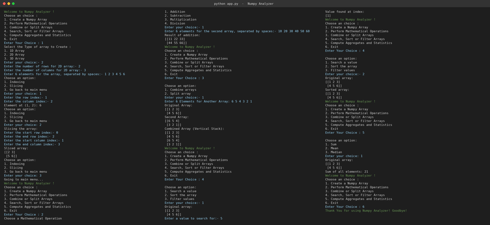

# 📊 NumPy Analyzer

A simple Python console-based *NumPy Analyzer* project that allows users to create and analyze 1D, 2D, and 3D NumPy arrays. Users can perform mathematical operations, indexing, slicing, searching, sorting, filtering, combining, splitting, and statistical calculations.

---

## 📌 Project Description

The NumPy Analyzer is a beginner-friendly Python project created to practice Python programming concepts and the NumPy library.

The program provides a menu-driven interface where users can create arrays and perform different operations on them during runtime.

---

## 🚀 Features

The project provides the following options:

- Create a NumPy Array (1D, 2D, or 3D)
- Perform Mathematical Operations
- Combine or Split Arrays
- Search, Sort, or Filter Arrays
- Compute Aggregates and Statistics
- Perform Indexing and Slicing
- Exit the program

---

## 🔢 Array Types

The program supports three types of arrays:

- *1D Array* – A one-dimensional array containing a sequence of elements.
- *2D Array* – A two-dimensional array arranged in rows and columns.
- *3D Array* – A three-dimensional array arranged in depth, rows, and columns.

---

## 📋 Main Menu

When the program starts, the following menu is displayed:

text
Welcome to Numpy Analyzer!

Choose an choice:
1. Create a Numpy Array
2. Perform Mathematical Operations
3. Combine or Split Arrays
4. Search, Sort or Filter Arrays
5. Compute Aggregates and Statistics
6. Exit

---

## ➕ Create a NumPy Array

The user can create a 1D, 2D, or 3D array by entering the required information.

For a 1D array, the user enters space-separated integers.

*Example*

text
Select the Type of array to Create:
1. 1D Array
2. 2D Array
3. 3D Array

Enter your choice: 1
Enter elements for 1D array: 10 20 30 40

*Output*

text
Elements: [10 20 30 40]
Elements added successfully!

For 2D and 3D arrays, the user must also enter the dimensions and the correct number of elements.

---

## 🧭 Indexing and Slicing

The program allows users to access individual elements or select a portion of an array.

- *Indexing* – Access an element using its index or row, column, and depth coordinates.
- *Slicing* – Extract a portion of an array using start and end indices.

---

## ➗ Mathematical Operations

The user can perform mathematical operations between the current array and another array of the same shape.

Available operations:

1. Addition
2. Subtraction
3. Multiplication
4. Division

The user enters the elements of the second array, and the program displays the result.

---

## 🗂️ Combine or Split Arrays

This feature provides two options:

- *Combine Arrays* – Combine the current array and another array using NumPy's vertical stacking operation (np.vstack).
- *Split Array* – Split an array into a specified number of sections using np.array_split.

---

## 🔍 Search, Sort, or Filter Arrays

The program allows users to work with array values.

- *Search a Value* – Check whether a value exists in the array and display matching positions.
- *Sort the Array* – Display the array values in sorted order.
- *Filter Values* – Display values less than or greater than a user-provided threshold.

---

## 📈 Compute Aggregates and Statistics

The program calculates basic statistical values for the current array.

- *Sum* – Calculates the sum of all array elements using np.sum.
- *Mean* – Calculates the average of all array elements using np.mean.
- *Median* – Calculates the median using np.median.

---

## 🛠️ Technologies Used

- *Python 3* – Programming language used to build the project.
- *NumPy* – Python library used for array creation and numerical operations.
- *VS Code* – Code editor used for development.
- *Git* – Version control.
- *GitHub* – Repository hosting and project management.

---

## 📁 Project Structure

text
│
├── main.py
├── output.png
└── README.md

---
## 📸 Project Output

## 📄 File Description

- main.py – Main Python program containing the NumPy Analyzer code.
- output.png – Screenshot of the program output.
- README.md – Project documentation and information.

---

## ▶️ How to Run

### 1. Install Python 3

Make sure Python 3 is installed on your computer.

Check the Python version:

bash
python --version

### 2. Install NumPy

Install the NumPy library using pip:

bash
pip install numpy

### 3. Open the Project

Open the project folder in VS Code or your preferred code editor.

### 4. Run the Program

Open the terminal in the project directory and run:

bash
python main.py

Follow the on-screen menu and enter the requested values.

---

## 🎯 Learning Objectives

This project helps in understanding and practicing:

- Python basics
- Variables and user input
- if-elif-else statements
- while loops
- Classes and objects
- Exception handling
- NumPy array creation
- 1D, 2D, and 3D arrays
- Indexing and slicing
- Mathematical operations
- Searching, sorting, and filtering
- Combining and splitting arrays
- Aggregate functions such as sum, mean, and median
- Menu-driven console applications

---

## 👨‍💻 Author

*PARMAR VISHAL*

---

Thank you for using the *NumPy Analyzer* project! ⭐